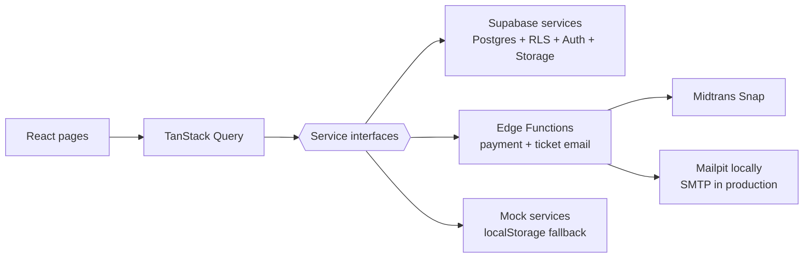
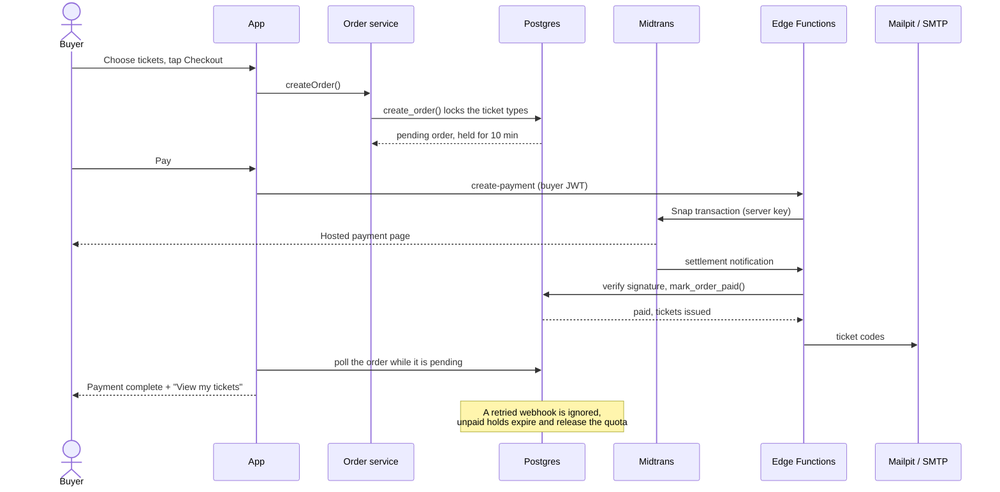

# Tixly

[](https://github.com/native-99/tixly/actions/workflows/ci.yml)

Tixly is a mobile-first event ticketing app. Buyers pick tickets and pay, then get a QR e-ticket. Organizers create events and track sales. Gate staff scan tickets at the entrance, and each ticket only works once.

> **Current stage: full Supabase backend.** Auth, Postgres, Row Level Security and Storage run
> locally through the Supabase CLI. The browser-only mock services are still there as a fallback:
> set `VITE_DATA_SOURCE=mock` in `.env.local` to use them.

**Live demo:** _coming soon (Cloudflare)_

## Demo accounts

On the login page, tap a demo account to sign in. The password for all of them is `demo1234`.
You can also log in with a one-time link: type an email and tap **Email me a login link**.

| Role | Email | What to try |
| --- | --- | --- |
| Buyer | `buyer@tixly.dev` | Buy tickets, pay (simulated), open the QR codes in **My tickets** |
| Organizer | `organizer@tixly.dev` | Create or edit an event with a poster and ticket types, then watch sales |
| Gate staff | `staff@tixly.dev` | Scan a QR with the camera or enter a code. The sample codes cover valid, already used and fake tickets |

Magic-link emails are captured by [Mailpit](http://127.0.0.1:54324) on local Supabase — nothing
is really sent.

## Screenshots

_Add screenshots here._

## Features

**Buyer**
- Browse upcoming events with search and filters for city, category and date
- Guests can open event details and pick tickets; login is only required at checkout
- Choose a quantity per ticket type. Tickets are held for 10 minutes during checkout
- Pay through Midtrans Snap, or use the simulated payment when no gateway keys are configured
- Tickets are emailed after payment, with one code per ticket
- My tickets grouped per event, with "Ticket 1 of 2" labels and one QR code per ticket
- Tap a QR code to open it fullscreen at the gate, with a screen wake lock where supported
- Orders page with payment status, totals, ticket counts, and a way to finish an unpaid order
- Tickets and orders work offline: the app shell is cached and the last loaded lists are kept on
  the device, so the QR codes still open without a signal

**Organizer**
- Create and edit events: poster, category, details, ticket types (price and quota), draft or published
- A quota can't be lowered below tickets that are already sold or on hold
- Sales progress for each event

**Gate staff**
- Camera QR scanner with a manual-entry fallback
- Result is valid, already used or invalid. A ticket can be checked in only once
- Staff can only check in tickets for their own organizer's events

**General**
- Pages are protected by role (buyer, organizer, staff)
- Every page has loading, empty and error states
- Mobile-first layout tested down to 320px wide
- Desktop layout: event grid, two-column event detail, and navigation in the header instead of the bottom bar
- Category poster illustrations until organizers upload their own poster
- Modern visual language: glass surfaces, gradient accents, soft layered shadows, and a floating
  action bar on mobile (Plus Jakarta Sans, indigo → violet palette)

## Architecture



The UI only talks to the **service interfaces** in `src/services/types.ts`. The Supabase
implementation in `src/services/supabase/` satisfies the same contracts, so no page code had to
change when the backend moved from the browser to Postgres.

### Data model

| Table | Purpose |
| --- | --- |
| `profiles` | One row per auth user: name, role (`buyer`, `organizer`, `staff`) and the organizer's gate link for staff |
| `events` | Event details, category, status (draft/published) and poster URL |
| `ticket_types` | Price and quota per event |
| `orders` / `order_items` | Checkout holds (10 minutes), the price paid per ticket type, and the gateway reference |
| `payment_events` | Raw gateway notifications, unique per transaction + status, so a retry is ignored |
| `tickets` | Issued QR tickets, one row per ticket |

Rows are protected by Row Level Security: buyers read their own orders and tickets, organizers
read and write their own events, staff check in tickets for their organizer's events. Reads that
need aggregates go through security-definer functions (`list_published_events`, `get_event`,
`list_my_events`, `list_my_tickets`, `list_my_orders`), and the checkout lifecycle runs inside `create_order`,
`pay_order` and `cancel_order`. Gateway-only functions (`mark_order_paid`,
`claim_payment_event`, `claim_ticket_email`) are executable by the service role alone.

### Payments

`create-payment` runs with the buyer's JWT, checks the order belongs to them, and creates a
Midtrans Snap transaction with the server key. The browser only ever sees the redirect URL.

`midtrans-webhook` verifies `sha512(order_id + status_code + gross_amount + serverKey)` before
doing anything. A settlement is recorded in `payment_events` (unique on transaction + status), then
`mark_order_paid` issues the tickets. Replaying the same notification is a no-op, and a payment
that lands after the hold expired is reported as `late_payment` for a manual refund instead of
overselling the quota.

Ticket emails go out from the webhook through `send-tickets`, which uses Mailpit's HTTP API
locally and SMTP in production. `claim_ticket_email` makes the send exactly-once even when the
webhook and the checkout page race. With `MIDTRANS_ENABLED=false` the whole gateway path is
skipped and the simulated payment runs instead, so the demo works without credentials.

### Checkout flow



### Offline tickets

Production builds register `public/sw.js`, which caches the app shell and the hashed build
assets. `My tickets` and `Orders` save their last successful response in `localStorage`
(`src/lib/offlineCache.ts`). When a request fails, the page shows that saved copy with an offline
banner instead of an error.

The saved profile (`profileFor` in `src/services/supabase/auth.ts`) means an offline reload can
still restore the session and open the QR codes. The cache is dropped when the account changes, so
one buyer's tickets never show up for another. Service workers only run in production; development
and the mock backend behave as before.

## Tech stack

React 19 · TypeScript · Vite · React Router · TanStack Query · Tailwind CSS · Vitest · oxlint · qr-scanner · qrcode.react · service worker (offline tickets) · Supabase (Postgres, Auth, Storage, RLS, Edge Functions) · Midtrans Snap

## Project structure

```
src/
  auth/        session state and role helpers
  components/  layout and reusable UI
  config/      demo accounts and event categories
  lib/         formatting, query keys, offline cache, small hooks
  mocks/       seed data and the localStorage "database"
  pages/       one folder per page
  routes/      router, paths, role guards
  services/    service interfaces + mock and Supabase implementations
  types/       shared domain types
public/
  sw.js        offline app shell (registered in production builds)
supabase/
  migrations/  schema, RLS policies and RPC functions
  functions/   create-payment, midtrans-webhook, send-tickets
  config.toml  local stack configuration
scripts/
  seed.mjs     fills the local database with the demo data
```

## Run locally

Requires Node.js 22 or newer, plus [Docker](https://docs.docker.com/get-docker/) for the local
Supabase stack.

```bash
npm install
npm run db:start        # starts Postgres, Auth, Storage, Mailpit and the Edge runtime
npm run db:reset        # applies supabase/migrations to the local database
npm run db:seed         # demo accounts, events, paid orders and QR codes
cp supabase/functions/.env.example supabase/functions/.env
npm run fn:serve        # create-payment, midtrans-webhook, send-tickets
npm run dev
```

Then open http://localhost:5173.

The local stack prints its keys; put them in `.env.local` (see `.env.example`):

```bash
supabase status -o env   # copy API URL, anon key and service-role key
```

Payments and ticket email are configured in `supabase/functions/.env` (see
`supabase/functions/.env.example`). Locally everything works out of the box: the gateway stays off,
so checkout uses the simulated payment, and the ticket email lands in Mailpit. To use Midtrans
sandbox, set `MIDTRANS_ENABLED=true` and paste the server key from
**Dashboard → Settings → Access keys (Sandbox)**. For real email, set `SMTP_HOST`, `SMTP_PORT`,
`SMTP_USER` and `SMTP_PASS` to the same credentials you use for Supabase Auth.

| Local service | URL |
| --- | --- |
| API (PostgREST + Auth) | http://127.0.0.1:54321 |
| Supabase Studio | http://127.0.0.1:54323 |
| Mailpit (captured emails) | http://127.0.0.1:54324 |

| Script | Purpose |
| --- | --- |
| `npm run dev` | Start the dev server |
| `npm test` | Run unit tests |
| `npm run typecheck` | Type-check the project |
| `npm run lint` | Lint the code |
| `npm run build` | Build for production into `dist/` |
| `npm run ci` | Run everything CI runs |
| `npm run db:start` | Start the local Supabase stack |
| `npm run db:stop` | Stop the local Supabase stack |
| `npm run db:status` | Show the local URLs and keys |
| `npm run db:reset` | Recreate the local database and apply the migrations |
| `npm run db:seed` | Load the demo data |
| `npm run fn:serve` | Serve the Edge Functions locally |
| `npm run test:payments` | Check the payment webhook, idempotency and ticket email end to end |

To go back to the browser-only mock backend, set `VITE_DATA_SOURCE=mock` in `.env.local`. The mock
data lives in local storage; clear the site's storage to reset it.

## CI/CD

**CI:** GitHub Actions (`.github/workflows/ci.yml`) runs on every push and pull request: typecheck → lint → unit tests → build.

**CD:** Cloudflare Workers Builds is connected to this repo and deploys every push to `main`.

- `wrangler.jsonc` serves `dist/` as static assets. `not_found_handling: "single-page-application"` returns `index.html` for unknown paths, so routes like `/my-tickets` still work after a refresh.
- In Cloudflare, set the build command to `npm run ci`. The same checks as GitHub Actions then run before every deploy, and a failing test stops the deploy.

| Cloudflare build setting | Value |
| --- | --- |
| Build command | `npm run ci` |
| Deploy command | `npx wrangler deploy` |

## Roadmap

- [x] Supabase: Auth, Postgres schema, Row Level Security, Storage for posters
- [x] Atomic ticket reservation in a Postgres function, so concurrent checkouts can't oversell
- [x] Midtrans Snap payments with a signature-checked, idempotent webhook
- [x] Ticket email after payment, exactly once per order
- [x] Expired holds released automatically (pg_cron)
- [x] Buyer order history, with payment status and ticket counts
- [x] Fullscreen QR at the gate and offline access to saved tickets
- [ ] Signed QR payloads, so a screenshot can't be reused
- [ ] Organizer sales dashboard (revenue per ticket type, check-in count, CSV export)
- [ ] Refunds and a real resend/void flow for late payments
