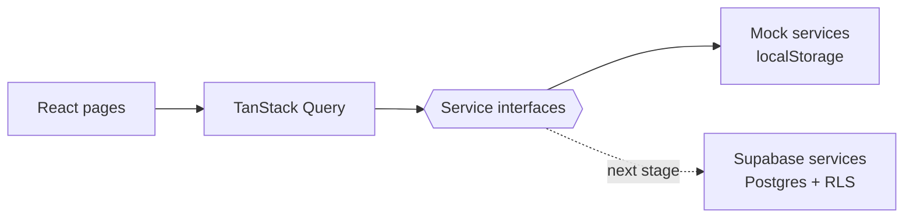
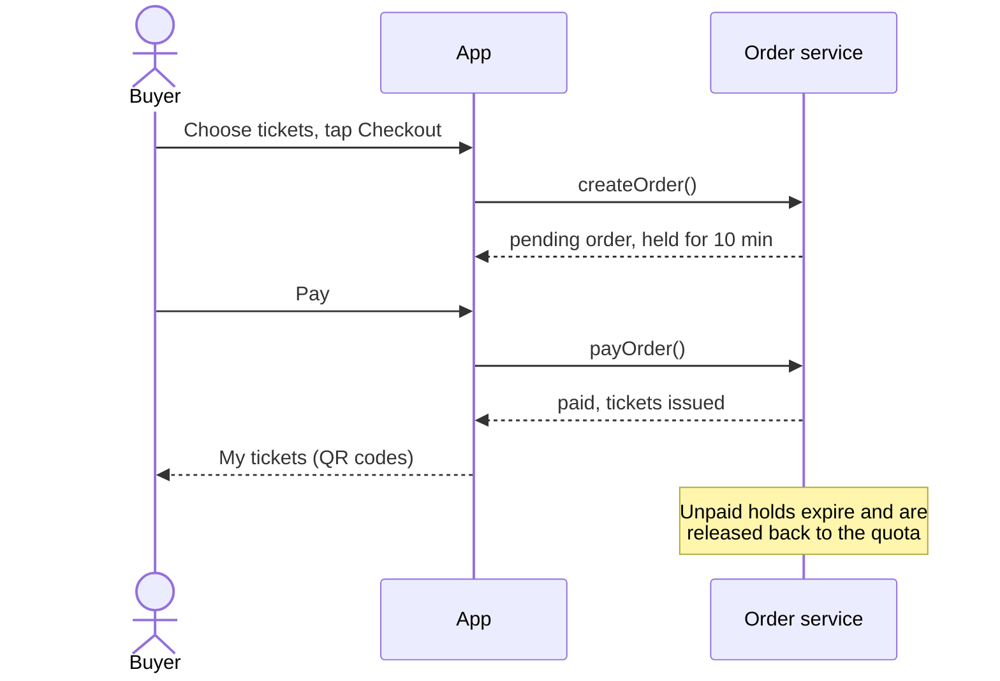

# Tixly

[](https://github.com/native-99/tixly/actions/workflows/ci.yml)

Tixly is a mobile-first event ticketing app. Buyers pick tickets and pay, then get a QR e-ticket. Organizers create events and track sales. Gate staff scan tickets at the entrance, and each ticket only works once.

> **Current stage: frontend with a mock backend.** All data lives in the browser through a mock service layer. The next stage moves the same service interfaces to Supabase (Postgres, Auth, Row Level Security, Storage).

**Live demo:** _coming soon (Cloudflare Pages)_

## Demo accounts

On the login page, tap a demo account to sign in. The password for all of them is `demo1234`.

| Role | Email | What to try |
| --- | --- | --- |
| Buyer | `buyer@tixly.dev` | Buy tickets, pay (simulated), open the QR codes in **My tickets** |
| Organizer | `organizer@tixly.dev` | Create or edit an event with a poster and ticket types, then watch sales |
| Gate staff | `staff@tixly.dev` | Scan a QR with the camera or enter a code. The sample codes cover valid, already used and fake tickets |

## Screenshots

_Add screenshots here._

## Features

**Buyer**
- Browse upcoming events and see the price and remaining tickets
- Choose a quantity per ticket type. Tickets are held for 10 minutes during checkout
- Simulated payment. Paying twice never issues tickets twice
- My tickets: one QR code per ticket

**Organizer**
- Create and edit events: poster, details, ticket types (price and quota), draft or published
- A quota can't be lowered below tickets that are already sold or on hold
- Sales progress for each event

**Gate staff**
- Camera QR scanner with a manual-entry fallback
- Result is valid, already used or invalid. A ticket can be checked in only once
- Staff can only check in tickets for their own organizer's events

**General**
- Pages are protected by role (buyer, organizer, staff)
- Every page has loading, empty and error states
- Mobile-first layout tested down to 320px wide

## Architecture



The UI only talks to the **service interfaces** in `src/services/types.ts`. Today they are backed by mock services. The Supabase implementation will plug into the same interfaces, so no page code has to change.

### Checkout flow



## Tech stack

React 19 · TypeScript · Vite · React Router · TanStack Query · Tailwind CSS · Vitest · oxlint · qr-scanner · qrcode.react

## Project structure

```
src/
  auth/        session state and role helpers
  components/  layout and reusable UI
  config/      demo accounts
  lib/         formatting, query keys, small hooks
  mocks/       seed data and the localStorage "database"
  pages/       one folder per page
  routes/      router, paths, role guards
  services/    service interfaces + mock implementations
  types/       shared domain types
```

## Run locally

Requires Node.js 22 or newer.

```bash
npm install
npm run dev
```

Then open http://localhost:5173.

| Script | Purpose |
| --- | --- |
| `npm run dev` | Start the dev server |
| `npm test` | Run unit tests |
| `npm run typecheck` | Type-check the project |
| `npm run lint` | Lint the code |
| `npm run build` | Build for production into `dist/` |
| `npm run ci` | Run everything CI runs |

To reset the demo data, clear the site's local storage in your browser.

## CI/CD

GitHub Actions (`.github/workflows/ci.yml`) runs on every push and pull request: typecheck → lint → unit tests → build.

Deployment to **Cloudflare Pages** runs only after CI passes on `main`, and only once these are set in the repo settings:

| Kind | Name |
| --- | --- |
| Variable | `CLOUDFLARE_PAGES_PROJECT` (the Pages project name) |
| Secret | `CLOUDFLARE_API_TOKEN` (permission: Cloudflare Pages: Edit) |
| Secret | `CLOUDFLARE_ACCOUNT_ID` |

`public/_redirects` sends every path to `index.html`, so routes like `/my-tickets` still work after a page refresh.

## Roadmap

- [ ] Supabase: Auth, Postgres schema, Row Level Security, Storage for posters
- [ ] Atomic ticket reservation in a Postgres function, with a k6 load test to prove there is no overselling
- [ ] Midtrans sandbox payments with an idempotent webhook
- [ ] Signed QR codes, e-ticket email, organizer dashboard, auto-release of expired holds
